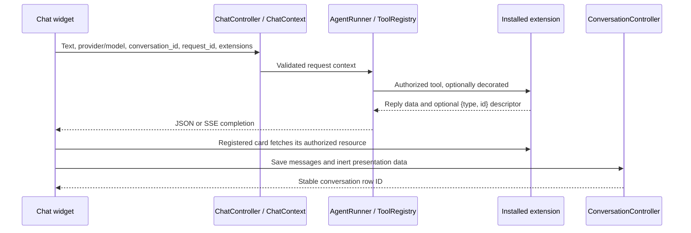
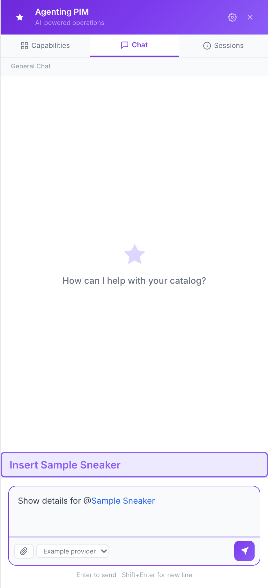
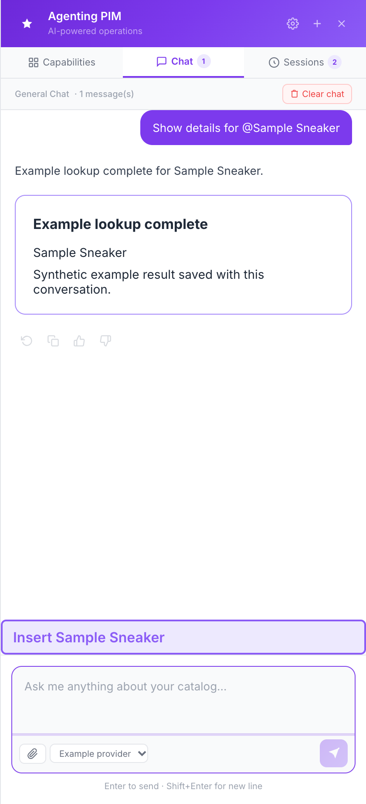
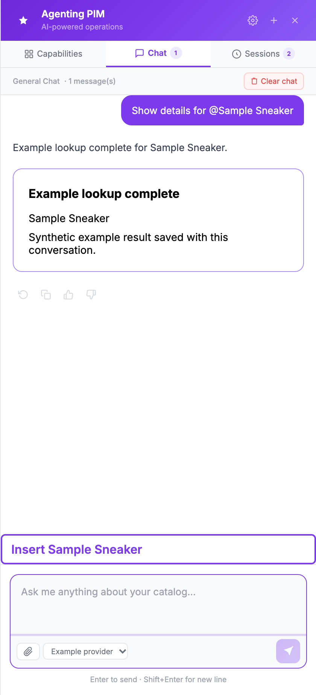

# Reviewing the chat extension hooks

The chat widget needs to support installed extensions that provide a chat provider,
attach structured selections to a prompt, or return a preview that continues after
the chat response. The same conversation must also remain usable after a reload
or a delayed save. These hooks keep that integration in installed packages while
preserving the native agent, provider choices and catalog permission checks.

Implementation links below refer to the reviewed UnoPIM core candidate. This guide and its screenshots are supplied separately for the UnoPIM documentation site. No extension account system,
credential store, API endpoint or product-specific renderer is part of this change.

## Read the change in this order

| Question | Start here | Decision to check |
| --- | --- | --- |
| What can an installed package register? | [ExtensionRegistry](https://github.com/TheDesignFounder/unopim/blob/ae7b778d7d6057db21e04d6f685d30003b902731/packages/Webkul/AiAgent/src/Chat/ExtensionRegistry.php), [ResultRendererRegistry](https://github.com/TheDesignFounder/unopim/blob/ae7b778d7d6057db21e04d6f685d30003b902731/packages/Webkul/AiAgent/src/Chat/ResultRendererRegistry.php) | Registration comes from trusted server code, never a client-supplied view/component name. |
| What crosses the HTTP boundary? | [ChatRequest](https://github.com/TheDesignFounder/unopim/blob/ae7b778d7d6057db21e04d6f685d30003b902731/packages/Webkul/AiAgent/src/Http/Requests/ChatRequest.php), [ChatContext](https://github.com/TheDesignFounder/unopim/blob/ae7b778d7d6057db21e04d6f685d30003b902731/packages/Webkul/AiAgent/src/Chat/ChatContext.php), [ChatController](https://github.com/TheDesignFounder/unopim/blob/ae7b778d7d6057db21e04d6f685d30003b902731/packages/Webkul/AiAgent/src/Http/Controllers/ChatController.php) | Identities and selections are validated; selections still need extension-specific authorization. |
| How does a tool produce a card? | [ToolRegistry](https://github.com/TheDesignFounder/unopim/blob/ae7b778d7d6057db21e04d6f685d30003b902731/packages/Webkul/AiAgent/src/Chat/ToolRegistry.php), [AgentRunner](https://github.com/TheDesignFounder/unopim/blob/ae7b778d7d6057db21e04d6f685d30003b902731/packages/Webkul/AiAgent/src/Chat/AgentRunner.php) | Decorators follow authorization. A bounded descriptor selects a registered renderer. Preview-only results can report `mutated: false`. |
| How do picker, keyboard and model controls interact? | [chat-widget.blade.php](https://github.com/TheDesignFounder/unopim/blob/ae7b778d7d6057db21e04d6f685d30003b902731/packages/Webkul/AiAgent/Resources/views/components/chat-widget.blade.php) | The native textarea keeps editing and IME. A picker may consume a key before Enter sends. Hiding one model does not remove its submitted value. |
| Why do old saves not erase new messages? | [ConversationController](https://github.com/TheDesignFounder/unopim/blob/ae7b778d7d6057db21e04d6f685d30003b902731/packages/Webkul/AiAgent/src/Http/Controllers/ConversationController.php), [MessageDisplay](https://github.com/TheDesignFounder/unopim/blob/ae7b778d7d6057db21e04d6f685d30003b902731/packages/Webkul/AiAgent/src/Chat/MessageDisplay.php) | Saves merge by identity under a conversation lock. Missing messages do not mean deletion. |
| How is existing data upgraded? | [Migrations](https://github.com/TheDesignFounder/unopim/blob/ae7b778d7d6057db21e04d6f685d30003b902731/packages/Webkul/AiAgent/Database/Migration) | Five additive migrations use nullable fields for old records; no provider enum or credential schema change. |

## Follow one request



The extension owns asynchronous work and its status endpoints. Mounting or
reopening a card does not itself authorize or execute an operation.

### Three identities with different jobs

| Field | Lifetime and use |
| --- | --- |
| `conversation_id` | Browser identity shared by sends and history saves. Stored as `client_id`, unique per admin. It is distinct from the database conversation row ID used by history routes. |
| `request_id` | UUID for one logical send. The widget retains it across SSE-to-JSON fallback and an explicit retry. An extension can use it to recover the same operation. |
| `message_id` | Identity of one transcript entry. Repeated saves do not duplicate that entry. A retry can create a new displayed entry while retaining the original request identity. |

Providing a request ID does **not** make arbitrary native tools execute exactly
once. An extension performing retriable effects must enforce its own durable
idempotency/receipt contract and handle uncertain outcomes. The decorator hook
allows that without rewriting the underlying tool. Tools still need their normal
authorization and confirmation checks.

### Provider and composer contracts

- A virtual provider uses a negative ID so it cannot collide with a persisted
  MagicAI platform. Its resolver supplies a request-time platform; the registry
  does not store credentials in the native provider table.
- `hide_single_model: true` hides the model selector only when exactly one model
  is available. That model remains selected and submitted. Native providers and
  providers with multiple models retain their controls.
- An installed composer receives `draft`, `cursor`, conversation, selection and
  disabled state. It emits `change` for structured context and `replace-draft`
  with `{start, end, text}` for bounded text replacement. Cursor offsets use the
  browser's UTF-16 indexing. Replacement restores focus/caret after Vue updates.
- `handleKey(event)` returns true when the composer consumes a key. IME input
  is left alone. Otherwise plain Enter sends and Shift+Enter keeps a newline.
- `references` contains display labels, rendered as escaped text. Longest-first
  matching and Unicode boundaries prevent overlapping/embedded names from
  becoming partial references. Labels are not resource IDs or access tokens.
- `extensions` is bounded inert request data (16 KiB total, depth 8, 2,048 nodes, at most 10 namespaces), whether supplied as an array or a JSON string. Composer keys use lowercase letters, digits, dots, underscores or hyphens and must start with a letter; component names start with `v-`. Each package resolves its own
  selections and checks the current user's access. `hasNewImages` distinguishes
  a new upload from paths retained from an earlier turn.
- A renderer's optional `consumesContext` names the selection to clear when that
  result type arrives. Clarification replies preserve it. A send snapshots the
  context so later draft changes cannot alter an in-flight request.

`COMPOSER_REFERENCES = 2` advertises full-label highlighting support. It is a hook
capability marker, not the package version or a negotiated API version.

### Result rendering and history are inert

A presentation descriptor has exactly two bounded strings: `type` and `id`.
Installed code maps the type to a Vue component and Blade view. Unknown types
remain in history and use the generic fallback; they cannot select arbitrary
templates. A renderer must authorize every resource read/write itself.

Native display fields (`result`, `product_url`, `download_url`, `_confirmed`,
`action`) are normalized separately. Result JSON is limited to 64 KiB, depth 8,
2,048 values and 16 KiB per string. Prototype-related keys and unsafe links are
rejected. Product links stay on the application origin; downloads can use local
paths or HTTP(S), without URL credentials or protocol-relative targets. Saved
data is for display, never a trusted tool instruction. Signed URLs are preserved,
not renewed; old fields absent from both browser and database cannot be recovered.

During streaming, a successful, final tool result emits a `tool_result` event
with these display fields before the SDK runs completion listeners. The widget
retains that result if a later provider call, completion listener, or connection
fails, then includes it in the normal conversation save. The error remains
visible; a failed stream does not automatically navigate or refresh the page.
The final `complete` event still supplies the normal response metadata. This
protects completed work without reporting the rest of a failed turn as successful.

### Persistence and backward compatibility

Database history is disabled by default: `ai-agent.history.enabled` reads
`AI_AGENT_HISTORY_ENABLED=false`. A host may opt in with that environment variable,
or an installed extension may set `config(['ai-agent.history.enabled' => true])`
in its provider's `boot()` method. This is a host-wide setting, including other chat
providers. Clear the configuration cache after an environment change. Disabling
history retains existing rows and uses browser storage without history HTTP calls;
all history endpoints reject requests while disabled.

Regeneration sends `deleted_message_ids` before submitting the replacement turn.
The server retains tombstones so delayed saves from another tab cannot recreate
removed messages; history responses include those IDs so local caches can discard
them too. A deletion-only save is allowed. Each save accepts at most 100 messages
and 100 deletion IDs. Incoming message IDs are read once and written in a bulk
upsert under the conversation lock, rather than queried individually.

An upsert finds or creates the current admin's conversation by client ID, then
locks it before merging messages. Existing message content, original timestamps,
native tool calls and token usage remain unchanged. Matching legacy records can
gain missing display fields. Confirmation only advances to true. Metadata adds
missing keys without replacing saved values. Removing an entire conversation is
still an explicit owner-scoped operation.

Legacy clients may omit the new fields. For those messages, position/role/content
produce a deterministic snapshot identity; it is not a general-purpose edit or
reordering protocol. Modern clients should supply stable message IDs and use a new
ID for changed content.

The browser caches only 50 messages per session and 20 sessions, but sends the
full transcript in batches of at most 100 messages. Browser saves are serialized;
server merging also handles delayed saves from other tabs. Reopening merges
server history with unsaved local entries. A session-selection counter prevents
a slow response from replacing the conversation selected more recently.

Run the four `2026_10_08_00000*` migrations and `2026_10_14_000005_add_message_deletion_identity` before serving the patched application.
They add message identity/presentation, conversation client identity, request
identity, native display data and deletion markers. A unique `(conversation_id, message_id)` index supports batched upserts; old nullable rows remain readable. Rolling back
those migrations removes the new metadata, so preserve a database backup if it
must be retained.

## Verify the contracts

From the UnoPIM root, Node 18+ can exercise the actual widget methods without an
application server, database or external provider:

```sh
node --test packages/Webkul/AiAgent/tests/JavaScript/*.test.cjs
```

The [harness notes](https://github.com/TheDesignFounder/unopim/blob/ae7b778d7d6057db21e04d6f685d30003b902731/packages/Webkul/AiAgent/tests/JavaScript/README.md) describe what is stubbed. Tests cover
caret replacement and bounds, IME/key delegation, reference boundaries, escaping,
model visibility and the actual submitted model/selection. The Pest bridge is
[ComposerContractTest](https://github.com/TheDesignFounder/unopim/blob/ae7b778d7d6057db21e04d6f685d30003b902731/packages/Webkul/AiAgent/tests/Unit/ComposerContractTest.php).

The Pest bridge skips when Node is unavailable; run the JavaScript command separately in a Node-enabled environment.

With UnoPIM's normal test dependencies and a migrated, isolated test database,
also run the relevant native regressions:

```sh
vendor/bin/pest packages/Webkul/AiAgent/tests
```

Extension integration tests should additionally cover descriptor ownership,
stale/concurrent history saves, retry receipts and asynchronous result recovery.
Those tests belong with their package and are not implied by the widget suite.
Automated checks do not replace browser checks of native chat, reopening history,
switching providers and using the installed composer's keyboard controls.


## Try the hooks without an external provider

Provider registration itself is small, but reproducing composer insertion,
custom rendering and server-backed history needs a composer and a deterministic
reply as well. The two example files below form that complete local fixture.
They require no external account or network call. They exercise the real widget,
request/context validation and conversation storage; the agent runner is a stub,
so this is not an LLM or tool-execution test.

Use a disposable, installed UnoPIM checkout of this branch with `APP_ENV=local`.
Run `php artisan migrate`, and enable the Agentic PIM chat interface in the host
configuration. Do not install other chat extensions for this example.

1. Create `app/Providers/ChatExampleServiceProvider.php` with the code below.
2. Add `App\Providers\ChatExampleServiceProvider::class,` to the returned array
   in `bootstrap/providers.php`.
3. Create `resources/views/chat-example.blade.php` with the second block.
4. Run `php artisan optimize:clear`, then open the native chat. Select
   **Example provider** if it is not already selected.
5. Type `Show details for ` and click **Insert Sample Sneaker**. The name is
   inserted at the caret and highlighted. Only the provider selector is shown:
   its sole model is still sent, and the stub rejects a different model.
6. Send the message. The registered result card appears. Wait for the conversation
   save to finish, then reload: the result remains.
7. For a stronger persistence check, clear this site's local/session storage
   while retaining the login cookie, reload, open **Sessions**, and reopen the
   saved conversation. The card is restored from server history.

The following captures are from the original pre-split fixture run on a fresh `3.x` installation; they are illustrative, not new browser evidence for this revision. Browser
checks assert that the hidden `example-only` model is submitted and that the
reopened conversation loads its descriptor from the server after browser storage
is cleared. This exercises the widget and persistence routes, not an external
model or its tool loop.

| Name insertion; only the provider selector is visible | Registered result card | Same result restored after reload |
| --- | --- | --- |
|  |  |  |

All labels and result data are synthetic. The example renderer has no resource
endpoint. A real renderer must authorize every resource request; a descriptor
alone grants no access. Remove the two fixture files and the provider entry,
then clear caches after testing. The runner override affects every chat request
in this local fixture, so do not use it in a shared or production installation.

```php
<?php

namespace App\Providers;

use Illuminate\Support\ServiceProvider;
use Symfony\Component\HttpFoundation\StreamedResponse;
use Webkul\AiAgent\Chat\AgentRunner;
use Webkul\AiAgent\Chat\ChatContext;
use Webkul\AiAgent\Chat\ExtensionRegistry;
use Webkul\AiAgent\Chat\ResultRendererRegistry;
use Webkul\MagicAI\Models\MagicAIPlatform;

/** Local, deterministic example. No remote provider is contacted. */
class ChatExampleServiceProvider extends ServiceProvider
{
    public function boot(): void
    {
        if (! $this->app->environment('local')) {
            return;
        }

        config(['ai-agent.history.enabled' => true]);

        $registry = $this->app->make(ExtensionRegistry::class);
        $registry->provider(-99, fn () => new MagicAIPlatform([
            'label' => 'Example provider', 'provider' => 'openai',
            'models' => 'example-only', 'status' => true,
        ]), [
            'label' => 'Example provider', 'models' => ['example-only'],
            'is_default' => true, 'hide_single_model' => true,
        ]);
        $registry->composer('example', 'v-example-composer', 'chat-example');
        $this->app->make(ResultRendererRegistry::class)->register(
            'example.lookup', 'v-example-result', 'chat-example', 'example',
        );

        $this->app->bind(AgentRunner::class, fn () => new class extends AgentRunner
        {
            public function __construct() {}

            public function run(ChatContext $context): array
            {
                abort_unless($context->model === 'example-only', 422);

                return [
                    'reply' => 'Example lookup complete for Sample Sneaker.',
                    'action' => 'agent_response',
                    'presentation' => ['type' => 'example.lookup', 'id' => 'sample-sneaker'],
                    'result' => ['name' => 'Sample Sneaker', 'status' => 'Example complete'],
                ];
            }

            public function runStreaming(ChatContext $context): StreamedResponse
            {
                $result = $this->run($context);

                return new StreamedResponse(static function () use ($result): void {
                    echo 'event: text_delta'."\n".'data: '.json_encode(['chunk' => $result['reply']])."\n\n";
                    echo 'event: complete'."\n".'data: '.json_encode($result)."\n\n";
                }, 200, ['Content-Type' => 'text/event-stream']);
            }
        });
    }
}
```

```blade
@pushOnce('scripts', 'chat-example')
<script type="text/x-template" id="example-composer">
    <button type="button" class="secondary-button" @click="insert">Insert Sample Sneaker</button>
</script>
<script type="text/x-template" id="example-result">
    <section v-if="descriptor.id === 'sample-sneaker'" class="p-5 border rounded-xl">
        <strong>Example lookup complete</strong>
        <p class="mt-3">Sample Sneaker</p>
        <p class="mt-2">Synthetic example result saved with this conversation.</p>
    </section>
</script>
<script type="module">
app.component('v-example-composer', {
    template: '#example-composer',
    props: ['draft', 'cursor', 'disabled'],
    emits: ['change', 'replace-draft'],
    methods: {
        insert() {
            if (this.disabled) return;
            this.$emit('change', { references: ['Sample Sneaker'] });
            this.$emit('replace-draft', { start: this.cursor, end: this.cursor, text: '@Sample Sneaker' });
        },
    },
});
app.component('v-example-result', {
    template: '#example-result',
    props: ['descriptor', 'visible'],
});
</script>
@endPushOnce
```
