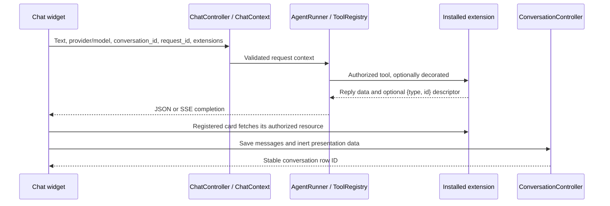

# Reviewing the chat extension hooks

The chat widget needs to support installed extensions that provide a chat provider,
attach structured selections to a prompt, or return a preview that continues after
the chat response. The same conversation must also remain usable after a reload
or a delayed save. These hooks keep that integration in installed packages while
preserving the native agent, provider choices and catalog permission checks.

All paths below are relative to this directory. No extension account system,
credential store, API endpoint or product-specific renderer is part of this change.

## Read the change in this order

| Question | Start here | Decision to check |
| --- | --- | --- |
| What can an installed package register? | [ExtensionRegistry](src/Chat/ExtensionRegistry.php), [ResultRendererRegistry](src/Chat/ResultRendererRegistry.php) | Registration comes from trusted server code, never a client-supplied view/component name. |
| What crosses the HTTP boundary? | [ChatRequest](src/Http/Requests/ChatRequest.php), [ChatContext](src/Chat/ChatContext.php), [ChatController](src/Http/Controllers/ChatController.php) | Identities and selections are validated; selections still need extension-specific authorization. |
| How does a tool produce a card? | [ToolRegistry](src/Chat/ToolRegistry.php), [AgentRunner](src/Chat/AgentRunner.php) | Decorators follow authorization. A bounded descriptor selects a registered renderer. Preview-only results can report `mutated: false`. |
| How do picker, keyboard and model controls interact? | [chat-widget.blade.php](Resources/views/components/chat-widget.blade.php) | The native textarea keeps editing and IME. A picker may consume a key before Enter sends. Hiding one model does not remove its submitted value. |
| Why do old saves not erase new messages? | [ConversationController](src/Http/Controllers/ConversationController.php), [MessageDisplay](src/Chat/MessageDisplay.php) | Saves merge by identity under a conversation lock. Missing messages do not mean deletion. |
| How is existing data upgraded? | [Migrations](Database/Migration) | Four additive migrations use nullable fields for old records; no provider enum or credential schema change. |

## Follow one request



The extension owns asynchronous work and its status endpoints. Mounting or
reopening a card does not itself authorize or execute an operation.

### Three identities with different jobs

| Field | Lifetime and use |
| --- | --- |
| `conversation_id` | Browser identity shared by sends and history saves. Stored as `client_id`, unique per admin. It is distinct from the database conversation row ID used by history routes. |
| `request_id` | UUID for one logical send. The widget retains it across SSE-to-JSON fallback and an explicit retry. An extension can use it to recover the same operation. |
| `message_id` | Identity of one transcript entry. Repeated saves do not duplicate that entry. A retry can create a new displayed entry while retaining the original request identity. |

Providing a request ID does **not** make arbitrary native tools execute exactly
once. An extension performing retriable effects must enforce its own durable
idempotency/receipt contract and handle uncertain outcomes. The decorator hook
allows that without rewriting the underlying tool. Tools still need their normal
authorization and confirmation checks.

### Provider and composer contracts

- A virtual provider uses a negative ID so it cannot collide with a persisted
  MagicAI platform. Its resolver supplies a request-time platform; the registry
  does not store credentials in the native provider table.
- `hide_single_model: true` hides the model selector only when exactly one model
  is available. That model remains selected and submitted. Native providers and
  providers with multiple models retain their controls.
- An installed composer receives `draft`, `cursor`, conversation, selection and
  disabled state. It emits `change` for structured context and `replace-draft`
  with `{start, end, text}` for bounded text replacement. Cursor offsets use the
  browser's UTF-16 indexing. Replacement restores focus/caret after Vue updates.
- `handleKey(event)` returns true when the composer consumes a key. IME input
  is left alone. Otherwise plain Enter sends and Shift+Enter keeps a newline.
- `references` contains display labels, rendered as escaped text. Longest-first
  matching and Unicode boundaries prevent overlapping/embedded names from
  becoming partial references. Labels are not resource IDs or access tokens.
- `extensions` is bounded inert request data. Each package resolves its own
  selections and checks the current user's access. `hasNewImages` distinguishes
  a new upload from paths retained from an earlier turn.
- A renderer's optional `consumesContext` names the selection to clear when that
  result type arrives. Clarification replies preserve it. A send snapshots the
  context so later draft changes cannot alter an in-flight request.

`COMPOSER_REFERENCES = 2` advertises full-label highlighting support. It is a hook
capability marker, not the package version or a negotiated API version.

### Result rendering and history are inert

A presentation descriptor has exactly two bounded strings: `type` and `id`.
Installed code maps the type to a Vue component and Blade view. Unknown types
remain in history and use the generic fallback; they cannot select arbitrary
templates. A renderer must authorize every resource read/write itself.

Native display fields (`result`, `product_url`, `download_url`, `_confirmed`,
`action`) are normalized separately. Result JSON is limited to 64 KiB, depth 8,
2,048 values and 16 KiB per string. Prototype-related keys and unsafe links are
rejected. Product links stay on the application origin; downloads can use local
paths or HTTP(S), without URL credentials or protocol-relative targets. Saved
data is for display, never a trusted tool instruction. Signed URLs are preserved,
not renewed; old fields absent from both browser and database cannot be recovered.

### Persistence and backward compatibility

An upsert finds or creates the current admin's conversation by client ID, then
locks it before merging messages. Existing message content, original timestamps,
native tool calls and token usage remain unchanged. Matching legacy records can
gain missing display fields. Confirmation only advances to true. Metadata adds
missing keys without replacing saved values. Removing an entire conversation is
still an explicit owner-scoped operation.

Legacy clients may omit the new fields. For those messages, position/role/content
produce a deterministic snapshot identity; it is not a general-purpose edit or
reordering protocol. Modern clients should supply stable message IDs and use a new
ID for changed content.

The browser caches only 50 messages per session and 20 sessions, but sends the
full transcript in batches of at most 100 messages. Browser saves are serialized;
server merging also handles delayed saves from other tabs. Reopening merges
server history with unsaved local entries. A session-selection counter prevents
a slow response from replacing the conversation selected more recently.

Run the four `2026_10_08_00000*` migrations before serving the patched application.
They add message identity/presentation, conversation client identity, request
identity and native display data. Old nullable rows remain readable. Rolling back
those migrations removes the new metadata, so preserve a database backup if it
must be retained.

## Verify the contracts

From the UnoPIM root, Node 18+ can exercise the actual widget methods without an
application server, database or external provider:

```sh
node --test packages/Webkul/AiAgent/tests/JavaScript/composer-contract.test.cjs
```

The [harness notes](tests/JavaScript/README.md) describe what is stubbed. Tests cover
caret replacement and bounds, IME/key delegation, reference boundaries, escaping,
model visibility and the actual submitted model/selection. The Pest bridge is
[ComposerContractTest](tests/Unit/ComposerContractTest.php).

With UnoPIM's normal test dependencies and a migrated, isolated test database,
also run the relevant native regressions:

```sh
vendor/bin/pest packages/Webkul/AiAgent/tests/Unit/ToolRegistryExtensibilityTest.php \
  packages/Webkul/AiAgent/tests/Unit/AgentMutationFlagTest.php \
  packages/Webkul/AiAgent/tests/Unit/ModelSelectionConfigTest.php \
  packages/Webkul/AiAgent/tests/Feature/ChatWidgetDefaultPlatformTest.php \
  packages/Webkul/AiAgent/tests/Feature/ChatWidgetVisibilityTest.php \
  packages/Webkul/AiAgent/tests/Feature/AgentRunnerTokenUsageTest.php
```

Extension integration tests should additionally cover descriptor ownership,
stale/concurrent history saves, retry receipts and asynchronous result recovery.
Those tests belong with their package and are not implied by the widget suite.
Automated checks do not replace browser checks of native chat, reopening history,
switching providers and using the installed composer's keyboard controls.
